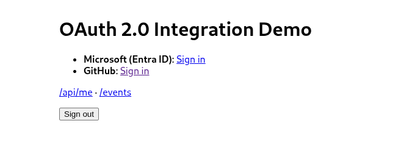
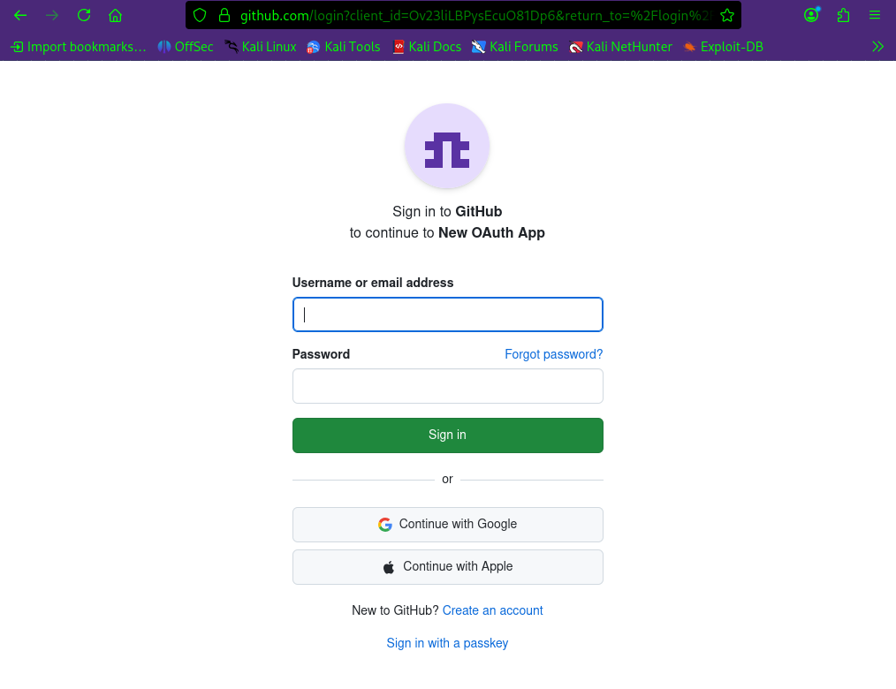
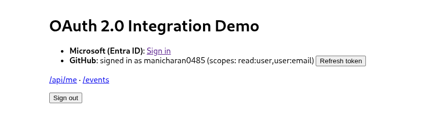

# OAuth 2.0 Integration Demo

[](https://github.com/manicharan0485/oauth-integration/actions/workflows/test.yml)

A small Node.js app showing the pieces of a real API integration:

- **OAuth 2.0 authorization code flow with PKCE (S256)** against **Microsoft Entra ID** and **GitHub**
- `state` parameter for CSRF protection, bound to the browser session
- Server-side token exchange with a client secret, plus **refresh-token** handling (Entra ID)
- Authenticated API calls: **Microsoft Graph** `GET /v1.0/me` and **GitHub** `GET /user`
- **Webhooks**
  - GitHub: HMAC-SHA256 signature verification on the raw body, constant-time compare
  - Microsoft Graph change notifications: `validationToken` handshake and `clientState` check
- Tests with `node --test` (no test framework needed)

## Demo (GitHub sign-in)

Run locally at `http://localhost:3000`.

**1. Signed out.** Both providers show a Sign in link.



**2. Redirect to GitHub.** The browser is sent to GitHub's authorize endpoint with `state` and the PKCE challenge. The user logs in at GitHub, so the app never sees the password.



**3. Signed in.** The server exchanges the code for a token and calls `GET /user`. The page shows the user and granted scopes.



GitHub sign-in was verified live. Microsoft Entra ID sign-in is implemented and unit-tested but has not been run against a live tenant.

## Run it

```bash
npm install
cp .env.example .env   # fill in values, then: export $(grep -v '^#' .env | xargs)
npm start              # http://localhost:3000
npm test
```

### Microsoft Entra ID setup
1. Entra ID > App registrations > New registration. Redirect URI (Web): `http://localhost:3000/auth/microsoft/callback`.
2. Certificates & secrets > New client secret. Put the value in `MS_CLIENT_SECRET`, the Application (client) ID in `MS_CLIENT_ID`.
3. API permissions: delegated `User.Read` (already added by default).

### GitHub setup
1. Settings > Developer settings > OAuth Apps > New. Callback URL: `http://localhost:3000/auth/github/callback`.
2. Put the client ID and secret in `.env`.
3. For webhooks, expose the app with a tunnel (e.g. `ngrok http 3000`), add a repo webhook pointing to `https://<tunnel>/webhooks/github`, content type `application/json`, and the same secret as `GITHUB_WEBHOOK_SECRET`. Received events appear at `/events`.

### Graph webhooks (optional)
Create a subscription (`POST /v1.0/subscriptions`) with `notificationUrl` = `https://<tunnel>/webhooks/graph` and `clientState` = `GRAPH_CLIENT_STATE`. Graph first sends a validation request, which the app answers automatically.

## Architecture

How the modules in `src/` fit together. Generated with [GitDiagram](https://gitdiagram.com/manicharan0485/oauth-integration).

```mermaid
flowchart TD

subgraph group_auth["OAuth flow"]
  node_oauth["OAuth and PKCE<br/>[oauth.js]"]
  node_providers["Provider definitions<br/>[providers.js]"]
end

subgraph group_app["App and sessions"]
  node_server["HTTP routes<br/>[server.js]"]
  node_session[("Session state<br/>[server.js]")]
  node_ui["Profile and events views<br/>[server.js]"]
end

subgraph group_hooks["Webhooks"]
  node_github_hook["GitHub signature check<br/>[webhooks.js]"]
  node_graph_hook["Graph notification check<br/>[webhooks.js]"]
  node_event_log[("In-memory events<br/>[server.js]")]
end

node_browser(("Browser"))
node_identity{{"Entra ID and GitHub"}}
node_profile_apis{{"Graph and GitHub profile APIs"}}
node_github_sender(("GitHub webhook sender"))
node_graph_sender(("Microsoft Graph"))

node_browser -->|"starts sign-in"| node_server
node_server -->|"binds state"| node_session
node_server -->|"builds redirect"| node_oauth
node_oauth -->|"reads endpoints"| node_providers
node_browser -->|"follows redirect"| node_identity
node_identity -->|"returns callback"| node_server
node_server -->|"checks state"| node_session
node_server -->|"exchanges code"| node_oauth
node_oauth -->|"posts token request"| node_identity
node_server -->|"fetches profile"| node_providers
node_providers -->|"requests profile"| node_profile_apis
node_server -->|"stores tokens and profile"| node_session
node_browser -->|"requests refresh"| node_server
node_server -->|"refreshes token"| node_oauth
node_server -->|"serves views"| node_ui
node_ui -->|"reads profile"| node_session
node_github_sender -->|"posts webhook"| node_server
node_server -->|"verifies signature"| node_github_hook
node_server -->|"records event"| node_event_log
node_graph_sender -->|"posts notification"| node_server
node_server -->|"checks notification"| node_graph_hook
node_graph_hook -->|"returns valid events"| node_event_log
node_ui -->|"reads events"| node_event_log

classDef toneBlue fill:#dbeafe,stroke:#2563eb,stroke-width:1.5px,color:#172554
classDef toneAmber fill:#fef3c7,stroke:#d97706,stroke-width:1.5px,color:#78350f
classDef toneMint fill:#dcfce7,stroke:#16a34a,stroke-width:1.5px,color:#14532d
classDef toneIndigo fill:#e0e7ff,stroke:#4f46e5,stroke-width:1.5px,color:#312e81
class node_oauth,node_providers,node_browser toneBlue
class node_server,node_session,node_ui toneAmber
class node_github_hook,node_graph_hook,node_event_log,node_profile_apis,node_github_sender toneMint
class node_identity,node_graph_sender toneIndigo
```



## Flow

```
Browser -> /auth/:provider        generate state + PKCE verifier, redirect to authorize endpoint
Provider -> /auth/:provider/callback?code&state
            verify state, POST code + code_verifier + client secret to token endpoint
            call the provider API with the access token, store session server-side
```

## Design notes and limits
- Tokens and sessions live in memory, and only a random session ID is in the (signed, httpOnly) cookie. A production app would use an encrypted store (Redis/DB) and a key vault.
- Delegated (user) flow shown here. For unattended admin scripts, Entra ID's client credentials flow (app-only, certificate preferred) is the equivalent.
- GitHub OAuth Apps do not issue refresh tokens by default; GitHub Apps do.
- The webhook handlers acknowledge quickly; real systems would queue the work and deduplicate by delivery ID.

MIT licensed.
